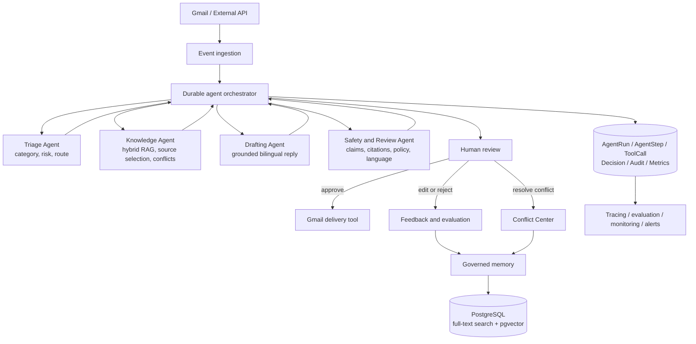

# MailOps AI — Agentic Orchestration Design and Roadmap

> **Planning update — 2026-10-28:** This is a long-term design, not implemented
> capability. For the next extension, follow
> [docs/17: Python Agent, MCP, and live evaluation](17-agent-development-implementation-plan.md),
> stages A0–A5. That plan supersedes this document's immediate implementation order
> and framework deferral in section 14. Its first deliverable is one bounded Agent;
> multi-agent, Gmail, vector search and Azure remain deferred. The prior portfolio
> phases 0–5 are complete; they did not implement this roadmap's phases 1–7.

## 1. Purpose

This document defines how MailOps AI will evolve from an AI-assisted email
workflow into a deployable, evaluable, and auditable human-in-the-loop agentic
orchestration platform.

It complements `07-productization-requirements-and-roadmap.md`. The Gmail-first,
provider-neutral, single-tenant-first, and protected-API decisions in that document
remain valid.

The target product description is:

> A human-in-the-loop multi-agent email operations platform that orchestrates
> bilingual triage, hybrid knowledge retrieval, conflict detection, grounded reply
> generation, safety review, and controlled Gmail actions.

This roadmap must not be implemented by only renaming existing services as agents.
Each agent needs a bounded responsibility, structured contracts, restricted tools,
observable execution, and explicit handoff conditions.

## 2. Design Principles

1. A deterministic orchestrator owns workflow state and safety decisions.
2. LLM agents provide bounded reasoning; they do not control infrastructure or
   approval policy.
3. Every agent input and output is validated with Zod before use or storage.
4. Every tool has an allowlist, timeout, audit record, and idempotency behavior.
5. Agent runs must pause, resume, retry, fail, and recover without losing state.
6. Factual knowledge, writing style, thread context, and reviewer feedback remain
   separate memory types.
7. Only approved factual knowledge may ground a reply.
8. Humans retain final authority over knowledge approval, conflict resolution, and
   real email sending.
9. Provider SDK types stay outside core domain and orchestration contracts.
10. Agent, prompt, model, retrieval, policy, and evaluation versions are traceable.
11. English and French are first-class inputs and evaluation dimensions.
12. The system remains safe and testable with deterministic mock providers.

## 3. Target Architecture



### Control boundary

The orchestrator is application code backed by durable PostgreSQL state. It:

- starts and resumes runs;
- selects the next allowed step from validated results;
- enforces human-review and safety policy;
- applies timeouts, retry limits, and step budgets;
- records decisions and state transitions;
- prevents unapproved tools or terminal-state reopening;
- ends, pauses, escalates, or fails a run.

Agents cannot change workflow policy, approve knowledge, disable safety controls,
or directly send an email.

## 4. Agent Responsibilities

### 4.1 Triage Agent

Purpose: understand the email and propose a safe processing route.

Responsibilities:

- identify English, French, mixed, or unknown language;
- classify category and intent;
- estimate confidence and risk;
- identify whether the request requires a human;
- propose the next permitted route.

Example result:

```ts
type TriageDecision = {
  category: EmailCategory;
  language: "en" | "fr" | "mixed" | "unknown";
  riskLevel: "low" | "medium" | "high";
  nextAction:
    | "SEARCH_KNOWLEDGE"
    | "TECHNICAL_QUEUE"
    | "HUMAN_REVIEW"
    | "NO_ACTION";
  confidence: number;
  reason: string;
};
```

The orchestrator validates this result and may override its route with deterministic
policy.

### 4.2 Knowledge Agent

Purpose: locate sufficient approved evidence for the current question.

Responsibilities:

- create English/French retrieval queries;
- call PostgreSQL full-text and vector-search tools;
- fuse or rerank results;
- identify relevant approved sources;
- report insufficient knowledge;
- surface possible duplicate or contradictory entries.

It may read approved knowledge. It may not approve, edit, merge, deactivate, or
delete knowledge.

### 4.3 Drafting Agent

Purpose: produce a reply grounded in selected knowledge and guided by a separate
style profile.

Responsibilities:

- answer in the email's primary language;
- use only knowledge supplied by the orchestrator;
- apply an approved style profile;
- return the IDs of all factual sources used;
- expose uncertainty instead of inventing an answer;
- always require human review during the target roadmap.

It cannot independently search the complete database or send email.

### 4.4 Safety and Review Agent

Purpose: evaluate a draft before human review.

Responsibilities:

- check whether the draft answers the original request;
- map factual claims to supplied approved knowledge;
- identify unsupported claims or invalid citations;
- detect privacy, payment, legal, complaint, and account-risk signals;
- check language and style consistency;
- recommend approve-for-review, revise, or escalate.

This agent is advisory. It cannot approve or send a reply.

## 5. Tool Model

Agents use registered tools rather than Prisma, Gmail SDKs, or arbitrary network
access.

```text
Email tools
├── readThread
├── readMessage
├── createGmailDraft
└── sendApprovedReply

Knowledge tools
├── searchApprovedKnowledge
├── hybridSearch
├── getKnowledgeEntry
└── reportPossibleConflict

Workflow tools
├── requestHumanReview
├── createKnowledgeCandidate
├── routeTechnicalIssue
└── recordDecision
```

Every tool contract must define:

- strict input and output schemas;
- authorized agent types;
- side-effect classification;
- timeout and retry policy;
- idempotency behavior;
- minimum logged metadata without private full-message bodies;
- mock implementation for tests.

Real sending is never a general-purpose Agent tool. It is a protected application
operation that verifies human approval, safety controls, dispatch state, and an
idempotency key before invoking the email provider.

## 6. Governed Memory

MailOps does not use a single unstructured "agent memory." It maintains separate
memory classes with different trust rules.

| Memory type | Contents | Use for factual grounding |
| --- | --- | --- |
| Thread memory | Current email conversation and participants | Yes, as request context |
| Approved knowledge | Reviewed FAQ, policy, and canonical answers | Yes |
| Style memory | Reviewed writing examples and tone rules | No |
| Feedback memory | Human edits, rejections, corrections, and scores | Evaluation only until reviewed |

New information follows a governed lifecycle:

```text
Observed answer or correction
→ Knowledge Candidate
→ Human Review
→ Approved Knowledge or Approved Style Example
→ Versioned retrieval index
```

An AI agent cannot promote its own output into trusted memory.

## 7. Durable Execution and Data Model

The existing `AIExecution`, classification history, automation state,
`ReplyDispatch`, audit events, and idempotency protections remain reusable.

The orchestration layer adds these concepts:

### AgentRun

- goal and triggering event;
- related thread and organization;
- current state and final outcome;
- policy and orchestration versions;
- start, pause, resume, completion, and failure timestamps;
- global step, time, and token budgets.

### AgentStep

- run and sequence number;
- agent type and task;
- schema-validated input and output;
- provider, model, and prompt version;
- latency and token usage;
- attempt count and status;
- error category without leaking private content.

### ToolCall

- owning run and step;
- tool name and version;
- validated input/output metadata;
- side-effect type and idempotency key;
- authorization decision;
- latency, attempts, and status.

### AgentDecision

- selected route;
- bounded reasoning summary;
- confidence and risk level;
- policy rule applied;
- human override and reviewer identity when applicable.

The database is the durable source of truth. A process crash must not require an
LLM to reconstruct the workflow from conversation text.

## 8. Retrieval and Agent Evaluation

### Hybrid retrieval

- keep PostgreSQL full-text search as the measurable baseline;
- introduce an embedding provider interface;
- store vectors with model, dimensions, content hash, and version;
- search only active approved knowledge;
- combine keyword and vector ranks deterministically;
- maintain separate factual and style retrieval paths;
- begin with exact vector search and add approximate indexes only when measured
  scale and latency justify them.

### Evaluation dimensions

Agent and system changes require a versioned English/French evaluation set.

Minimum metrics:

- classification precision, recall, F1, and confidence calibration;
- routing accuracy and inappropriate-automation rate;
- retrieval Recall@K and source relevance;
- groundedness and unsupported-claim rate;
- citation validity;
- human acceptance, edit, rejection, and escalation rates;
- end-to-end completion and recovery rates;
- latency, tokens, estimated cost, retries, and provider failures;
- English/French quality parity;
- prompt-injection, PII leakage, and unauthorized-tool-call results.

LLM-as-a-Judge may supplement evaluation, but it must be calibrated against a
human-reviewed sample and must not be the only production acceptance criterion.

## 9. Python and SQL Evaluation Package

The product application remains TypeScript. A separate Python package provides ML,
analytics, and LLMOps evidence without creating an unnecessary runtime service.

```text
evals/
├── datasets/
├── metrics/
├── judges/
├── red_team/
├── analytics/
├── run_evaluation.py
└── tests/
```

It will:

- run versioned offline evaluations;
- calculate classification and retrieval metrics;
- compare model, prompt, policy, and retrieval versions;
- execute red-team scenarios;
- query orchestration telemetry with SQL;
- generate machine-readable and reviewer-readable reports;
- fail CI quality gates when agreed regression thresholds are exceeded.

Predictive modeling is optional. It should be introduced only for a justified use
case, such as predicting human escalation risk, and only after enough reviewed data
exists.

## 10. Cloud and Operational Architecture

The runtime stays cloud-adapter-neutral. To demonstrate alignment with the target
job requirements, the first portfolio deployment may use:

```text
Azure Container Apps
├── Next.js web/API application
├── agent worker
└── scheduled or event-driven jobs

Azure Database for PostgreSQL
└── pgvector

Azure Service Bus
└── durable work queue

Azure Key Vault + Managed Identity
└── Gmail OAuth and AI provider secrets

OpenTelemetry + Application Insights
└── traces, metrics, logs, dashboards, and alerts
```

AKS is deferred until Kubernetes-specific scale or platform requirements justify
its operational cost. An AKS reference deployment may be documented later without
making it the first hosting target.

Required operational controls:

- containerized, reproducible builds;
- infrastructure as code;
- CI lint, typecheck, unit, integration, evaluation, and build gates;
- separate local, staging, and production configuration;
- secret rotation and least-privilege identities;
- database migrations, backups, and restore testing;
- structured logs, traces, metrics, dashboards, and alerts;
- bounded retries, dead-letter handling, and replay tools;
- health, readiness, dependency, and synchronization checks;
- deployment rollback and incident runbooks.

## 11. Responsible AI and Enterprise Readiness

The portfolio may demonstrate regulated-environment-ready practices, but it must not
claim alignment with a private enterprise platform whose internal standards have
not been reviewed.

Required artifacts:

- architecture decision records;
- data classification and retention policy;
- threat model and abuse cases;
- system card and model/prompt inventory;
- risk taxonomy and human-approval policy;
- retrieval and generation evaluation report;
- automated prompt-injection and data-leakage tests;
- monitoring and incident-response playbook;
- change, model, prompt, and policy version history;
- production-readiness and handoff checklist;
- fit-gap assessment template for onboarding another use case;
- documented authenticated API and connector contracts.

## 12. Mapping to Target Job Capabilities

| Target capability | MailOps evidence |
| --- | --- |
| Reasoning and planning | Triage plans and structured route decisions |
| Multi-agent systems | Four bounded agents coordinated by a durable orchestrator |
| RAG and vector search | PostgreSQL FTS + pgvector hybrid retrieval |
| APIs and tools | Restricted Gmail, knowledge, and workflow tools |
| Enterprise knowledge | Candidate → review → approved knowledge governance |
| Memory | Separate thread, factual, style, and feedback memory |
| Workflow automation | Durable state, pause/resume, retry, escalation, and recovery |
| Python and SQL | Offline evaluation, analytics, red-team, and telemetry queries |
| Reusable engineering | Provider, agent, tool, policy, connector, and evaluator contracts |
| Cloud-native delivery | Containers, queues, managed PostgreSQL, IaC, and CI/CD |
| Observability and LLMOps | Traces, metrics, prompt/model versions, cost, quality gates |
| Responsible AI | Human authority, risk gates, audit, privacy, and evaluation |
| Bilingual delivery | English/French processing and quality-parity evaluation |

## 13. Delivery Roadmap

Each phase ends with automated tests, updated documentation, a manual acceptance
checklist, and explicit remaining risks.

### Phase 1 — Agent orchestration foundation

- define Agent, Tool, and Orchestrator contracts;
- add durable AgentRun, AgentStep, ToolCall, and AgentDecision records;
- move the current classification → retrieval → drafting flow behind the
  orchestrator;
- support step success, failure, bounded retry, pause, and resume;
- preserve mock/Gemini providers, full-text retrieval, and simulated sending;
- expose a minimal execution-trace view.

**Exit:** one synthetic email produces a complete, inspectable, and recoverable
agent workflow trace.

### Phase 2 — Bounded specialist agents and tools

- implement Triage, Knowledge, Drafting, and Safety/Review agents;
- implement the Tool Registry and per-agent allowlists;
- add timeout, step, retry, and token budgets;
- prevent direct agent database access and delivery;
- test invalid output, unauthorized tool calls, and interrupted handoffs.

**Exit:** agents have genuinely different responsibilities and exchange validated
structured results under orchestrator control.

### Phase 3 — Hybrid RAG and governed memory

- add the embedding provider and pgvector migration;
- implement hybrid retrieval and evaluation against full-text search;
- separate factual knowledge from style memory;
- add embedding lifecycle and re-indexing;
- surface possible knowledge conflicts for human resolution.

**Exit:** every factual draft is traceable to approved sources and hybrid retrieval
has measured results against the baseline.

### Phase 4 — Python evaluation platform

- establish redacted English/French datasets;
- implement classification, routing, retrieval, grounding, and safety metrics;
- add calibrated LLM-as-a-Judge experiments;
- add prompt-injection, PII, and tool-permission red-team cases;
- compare versions and introduce initial CI regression gates.

**Exit:** model, prompt, policy, and RAG changes produce repeatable evaluation
reports and cannot silently regress protected metrics.

### Phase 5 — Gmail and real workflow integration

- implement Gmail OAuth, initial sync, Pub/Sub/history processing, watch renewal,
  reconciliation, and sync health;
- execute the agent workflow in Gmail Shadow Mode;
- create Gmail drafts without sending;
- enable human-confirmed delivery only after idempotency, reconciliation, and kill
  switches pass canary tests.

**Exit:** Gmail messages enter the workflow automatically and an approved response
can be delivered exactly once with a complete audit trail.

### Phase 6 — Azure productization

- containerize the web/API and worker workloads;
- deploy Azure Container Apps, PostgreSQL/pgvector, queueing, Key Vault, and managed
  identities;
- add infrastructure as code and GitHub Actions CI/CD;
- instrument OpenTelemetry and create operational dashboards and alerts;
- test migrations, backups, restore, retry, dead-letter, rollback, and incident
  procedures.

**Exit:** staging is reproducibly deployed, observable, recoverable, and protected
by automated quality gates.

### Phase 7 — Enterprise readiness and reusable assets

- complete Responsible AI, security, privacy, and model-risk artifacts;
- document reusable agent, tool, connector, policy, and evaluation patterns;
- publish API/OpenAPI and integration guidance;
- create production-readiness, handoff, discovery, and fit-gap templates;
- run a second synthetic organization configuration to prove reuse.

**Exit:** the repository demonstrates not only a working application, but reusable
platform patterns, governance evidence, and onboarding readiness.

## 14. Immediate Implementation Slice

The next implementation task is deliberately limited to Phase 1:

1. add AgentRun and AgentStep persistence;
2. define the first Orchestrator contract;
3. record classification, retrieval, and drafting steps;
4. support failed-step retry and human-wait state;
5. add unit and integration tests;
6. add a minimal execution-trace page.

This slice does not add Gmail, pgvector, real sending, Azure resources, unrestricted
agent loops, or a new orchestration framework. A framework such as LangGraph should
be evaluated through an architecture decision record after the contracts and
required durability semantics are clear.

## 15. Explicit Non-Goals

- creating many agents only to satisfy terminology;
- unrestricted agents that communicate or loop without budgets;
- allowing AI to approve knowledge, resolve conflicts, or send mail;
- rewriting the TypeScript product in Python;
- adopting AKS before a Kubernetes requirement exists;
- adding a predictive model without sufficient reviewed data and a measurable use
  case;
- claiming production financial-services experience or private-platform compliance;
- hiding failures, evaluation limitations, or human-review dependencies.

## 16. Primary Technical References

- [Azure Container Apps jobs](https://learn.microsoft.com/en-us/azure/container-apps/jobs)
- [Managed identities in Azure Container Apps](https://learn.microsoft.com/en-us/azure/container-apps/managed-identity)
- [Azure Container Apps Key Vault references](https://learn.microsoft.com/en-us/azure/container-apps/manage-secrets)
- [OpenTelemetry in Azure Container Apps](https://learn.microsoft.com/en-us/azure/container-apps/opentelemetry-agents)
- [pgvector on Azure Database for PostgreSQL](https://learn.microsoft.com/en-us/azure/postgresql/extensions/how-to-use-pgvector)
- [Gmail push notifications](https://developers.google.com/workspace/gmail/api/guides/push)
- [pgvector](https://github.com/pgvector/pgvector)
