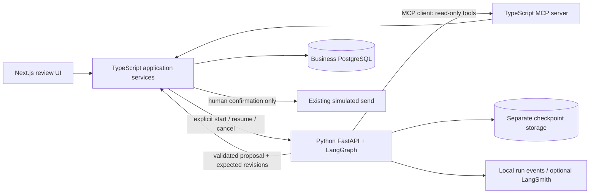

# MailOps AI — Python Agent, MCP, and Live Evaluation Implementation Plan

Decision date: **2026-10-28**.

Status: **A0–A3 complete (A3: 2026-10-30); A4 in progress (mock only); A5 mock UI integrated; portfolio closure pending.** See
[the A0 closure](agent/a0-closure.md), [A1 verification](agent/a1-mcp-tools-and-client.md)
[A2 verification](agent/a2-bounded-workflow-and-tracing.md), and
[A3 verification](agent/a3-persistence-and-safe-commit.md), and [A5 mock integration](agent/a5-mock-review-ui.md). Python/FastAPI, LangGraph,
MCP, persistent recovery, human continuation and safe business commits are implemented.
Live evaluation results and live tracing verification are not claimed.

## 1. Purpose, authority, and scope

Extend the completed portfolio baseline with demonstrable AI Agent development:
**Python + FastAPI + LangGraph, MCP tools, real-model evaluation, and execution tracing**.
Keep the Next.js/TypeScript product and its existing business invariants.

The user selected this direction and requested a plan first, with no business-code
changes or Git commit. Execute stages only when subsequently requested. Use stage
IDs **A0–A5**, distinct from the completed phases 0–5 in [docs/09](09-code-inventory-and-career-implementation-plan.md).
This document takes precedence over the immediate implementation sequence in
[docs/08](08-agentic-orchestration-design-and-roadmap.md) for this extension.
Docs/07–08 remain long-term designs, not a feature-completion inventory.

In scope for staged implementation:

- one bounded, tool-using Agent, with deterministic policy around model decisions;
- a Python/FastAPI service with LangGraph and a mock/live model boundary;
- a TypeScript MCP server reusing current business services;
- durable checkpoints, human pauses, safe replay, cancellation, and tracing;
- an isolated synthetic demonstration dataset and real-model evaluation on it;
- a minimal execution/review experience in the existing application.

Still deferred: multiple autonomous agents, Gmail/Graph/SMTP, real sending, mailbox
synchronization, pgvector/embeddings, cloud deployment, production workers/queues,
product authentication/RBAC/multi-tenancy, attachment-content processing, and A2A.
These are not prerequisites for A0–A5. Local service credentials and run-scoped
capability checks below are integration controls, not a new product login system.

## 2. Existing assets and actual integration gaps

| Existing asset | Reuse | Required extension |
| --- | --- | --- |
| `lib/ai/provider.ts`, Gemini/mock adapters | Structured classification/draft contracts and metadata conventions | Python model adapter with tool-calling support; existing TS interface has only classify/draft methods and is not a tool-calling API |
| `lib/processing/service.ts` | Current routing, transactional draft persistence, human editing and simulated confirmation | Extract only the reusable preparation/commit boundaries needed for Agent results; current function combines retrieval, model invocation, and persistence |
| `lib/workflow/context.ts`, `transaction.ts` | Context hashes, revision checks, terminal-state protection | Bind each run and resume to current canonical thread and expected business revisions |
| `lib/knowledge/search.ts`, `revisions.ts` | Active-approved full-text retrieval and immutable source versions | Bounded MCP adapters with exact returned revisions and content limits |
| `lib/processing/evidence.ts` | Immutable input/source evidence | Bind evidence to Agent run, tool results, and accepted proposal without rewriting historical snapshots |
| `lib/evaluation/benchmark/*`, `scripts/run-ai-benchmark.ts` | Frozen datasets, manifests, resume, case reports, baseline behavior | Versioned Agent result format and explicit baseline-vs-Agent comparison; current comparator only allows different retrieval configurations under matching implementation/runtime |
| Inbox and knowledge review pages | Existing editing, approval, conflict feedback | Run status, tools/evidence, pause/resume/cancel and safe stale-result handling |
| Existing integration tests and Playwright | Protection against business regressions | Python tests, cross-language contracts, MCP integration and restart/replay scenarios |

The existing evaluation is TypeScript-based and its published Phase 3 evidence is
mock-based. Exact-claim matching is a conservative proxy, not semantic factuality.
Do not relabel it as a completed Python/live evaluation platform.

## 3. Architecture and ownership decisions

### 3.1 Service boundaries

- **TypeScript owns business truth:** classification review, knowledge approval,
  draft writes, evidence validity, conflict decisions, and simulated-send records.
  Python must not directly write business tables or implement a second approval policy.
- **Python owns execution:** model/tool loop, graph state, budgets, checkpoints,
  and execution events. Checkpoint state is not approval authority.
- **MCP owns transport and tool contracts:** adapters call shared services rather
  than copy search/approval logic. It is not an authorization mechanism by itself.
- The Agent returns a structured proposal. A deterministic TS command accepts it
  only after validating evidence and current business revisions in a transaction.
  That command is not a model-selectable tool.
- Use one bounded Agent first. Classification, policy checks, retrieval and draft
  assembly can be separate nodes without claiming separate autonomous agents.
- Keep the existing workflow selectable as the default baseline. Agent execution
  is opt-in; failures do not silently start a second model workflow.

### 3.2 Local topology and storage

Proposed layout (not created by this plan): `services/agent/` for Python,
`services/mcp/` for the TS MCP entry point, `contracts/agent/` for shared fixtures
and versioned schemas. Final names and pinned versions are recorded in A0.

Use FastAPI for explicit run commands and status, and MCP Streamable HTTP on
loopback for the local tools service. Keep Python and MCP ports configurable and
check availability rather than reusing ports occupied by other projects.
The browser talks through Next.js, not directly to privileged service endpoints.
Disable cross-origin access by default, validate host/origin where applicable,
require local service credentials, and reject arbitrary connection destinations.

Use PostgreSQL-backed LangGraph checkpoints in a separate local database/role.
Python receives checkpoint credentials, not business-database credentials. Business
schema changes use additive Prisma migrations. Library-owned checkpoint schema
setup/upgrades use an explicit, versioned initialization procedure for that database;
do not run arbitrary checkpoint DDL against Prisma's business schema.

An isolated synthetic business database is required for Agent experiments. Do not
reset, seed over, or export the existing development Inbox: its data has not been
established as entirely synthetic. Explicitly configure database URLs per process.

### 3.3 Contract, replay, and safety invariants

Define JSON-safe, versioned contracts validated with Zod in TypeScript and Pydantic
in Python; shared fixtures must prove compatibility. Include:

- `runId`, command/idempotency key, contract/graph/policy/prompt versions;
- canonical thread identity, source context hash, classification revision and
  expected current draft/review identity, including the no-prior-draft case;
- retrieved entry/revision IDs, query/tool/result identities and evidence hashes;
- run status, sanitized error code, retryability, timestamps and model metadata;
- a structured final proposal or a structured human-escalation reason.

Run statuses are execution states (for example RUNNING, WAITING_FOR_HUMAN,
SUCCEEDED, FAILED, CANCELLED, STALE); they must not silently become new business
approval states. Record the mapping in A0. Low-confidence classification continues
to require human review; high-confidence routing retains current policy.

MCP tools initially expose only `get_thread_context`, `search_approved_knowledge`,
and `get_knowledge_revision`. Return bounded text and opaque references, never raw
headers, attachments, arbitrary files, SQL, or URLs. Enforce current-run/thread scope
in the server using a server-issued capability, not a model-supplied identifier.
Inactive knowledge may be displayed in human history but is ineligible for new
Agent grounding. A previously captured version must still be current/eligible at commit.

Retain one-source draft grounding initially, matching the current domain contract.
The Agent may inspect several candidates, but must escalate if the answer requires
unsupported multi-source synthesis or unresolved conflicting evidence.

No tool approves knowledge, edits human text, confirms drafts, or sends mail.
Email and tool text are untrusted input; policy enforcement remains executable code.

Model/tool retry is **at-least-once**, not exactly-once. An interrupted model request
can incur usage without a saved result. Use bounded retries and record unknown usage.
For TS commits, persist an idempotency receipt with the business mutation in the
same transaction: identical replay returns the prior result, changed payload under
the same key is rejected. Checkpoint writes and business commits are not one atomic
transaction; reconcile their gap through receipts and current-state reads.

The old and Agent paths may race: revision checks must protect against both, including
two runs starting before any draft exists. Only one active executor may advance a
run, using a persisted lease/fencing mechanism. Cancellation must block late commits;
it cannot promise to undo a provider request already accepted externally.
The TS side stores the accepted run identity, execution fence and cancellation state
needed by its commit guard. It checks them in the same transaction as the proposal
mutation, rather than trusting a Python status read performed before the transaction.
Graph checkpoints remain Python-owned; the TS guard is narrowly scoped business
admission state, not a duplicate graph engine.

## 4. Stage order and progress

A0–A3 are complete; A4 is **in progress (mock only)** and A5 is **in progress (mock UI integrated)**. A0 → A1 → A2 → A3 → A4 → A5 is the delivery
order. Dataset/rubric and trace contracts begin in A0; instrumentation begins in A2,
so evaluation and observability are not retrofitted after the Agent is built.

| Stage | Deliverable | Depends on | Status |
| --- | --- | --- | --- |
| A0 | Architecture/contracts, isolated fixtures, preregistered evaluation protocol | Completed phases 0–5 | Complete — 2026-10-29 |
| A1 | Real MCP server/client contract over current services | A0 | Complete — 2026-10-29 |
| A2 | Python/LangGraph bounded tool-using workflow and trace events | A1 | Complete — 2026-10-30 |
| A3 | Durable recovery, human pauses, concurrency and safe business commit | A2 | Complete — 2026-10-30 |
| A4 | Real-model baseline/Agent evaluation and tracing evidence | A3 | In progress — mock rehearsal/materials ready; live deferred by user |
| A5 | Integrated review demonstration and portfolio closure | A4 live gates deferred by user | In progress — mock UI integrated; narrated demo/portfolio closure pending |

### A0 — Contracts, fixtures, and evaluation protocol

Tasks:

- **A0-T1:** Write an architecture decision covering language/service boundaries,
  persistence ownership, MCP transport, schema ownership, errors, rollout/fallback,
  and the graph/business state mapping. Pin compatible Python, SDK and checkpoint
  versions after checking current official documentation. No unnecessary frameworks.
- **A0-T2:** Define cross-language request/result fixtures, capability scope, start/
  resume/cancel semantics, idempotency/fencing rules and trace correlation fields.
- **A0-T3:** Prepare isolated synthetic data and repeatable setup/cleanup commands.
  Preserve the existing TS baseline and its historical reports unchanged.
- **A0-T4:** Prepare at least 60 tuning and 40 frozen holdout cases, balanced across
  English/French, split by scenario family to avoid translated/paraphrased leakage.
  Cover known/unknown questions, ambiguity, conflicting/retired knowledge, injection,
  fake personal-data canaries, tool failures and escalation. Separate correctness
  fault-injection fixtures from model-quality cases. Review labels before freezing.
- **A0-T5:** Freeze metric definitions, human rubric, model settings, live-run budget
  fields and comparison policy before seeing candidate holdout results.

Acceptance:

- **A0-A1:** Contracts specify every data owner and replay boundary; there is no
  direct Python business-table write or model-exposed approval command.
- **A0-A2:** Positive/negative contract fixtures validate on both sides; unknown
  versions, invalid enums, oversized data and missing revisions fail explicitly.
- **A0-A3:** Synthetic setup/cleanup runs only against an explicit disposable target;
  a sentinel proves the development database is unchanged.
- **A0-A4:** Dataset counts, family split, labels, hashes and prospective quality gates
  are recorded. No claim of model-quality success is made from mock execution.

### A1 — MCP tools backed by existing services

Tasks:

- **A1-T1:** Implement the three read-only tools above with official MCP SDKs,
  structured schemas, bounded results, timeouts and sanitized errors.
- **A1-T2:** Reuse TS knowledge/context services; add only the focused service seam
  needed for reading an authorized, versioned snapshot.
- **A1-T3:** Add a Python MCP client integration fixture exercising real protocol
  initialization, tool discovery, invocation, error handling and reconnection.
- **A1-T4:** Test wrong credentials, wrong-run/thread references, retired knowledge,
  invalid arguments, output limits, timeout, and adversarial text in tool results.

Acceptance:

- **A1-A1:** Python discovers and calls the actual MCP server; this is not a REST
  endpoint merely named MCP. A synthetic thread yields traceable approved revisions.
- **A1-A2:** All scope/eligibility/validation failures are enforced server-side;
  tool enumeration exposes no write, approval, send, filesystem or arbitrary HTTP tool.
- **A1-A3:** Existing retrieval and evidence regression tests pass; neither service
  loads private development data or invokes a live model during automated tests.

### A2 — Bounded Python/LangGraph Agent

Tasks:

- **A2-T1:** Add FastAPI run/status interfaces and Python Gemini/mock model adapters.
  Use LangChain components where useful for model/tool integration; avoid wrapping
  every existing service solely to add framework names.
- **A2-T2:** Build a graph with deterministic policy gates and a genuine model-driven
  tool loop. The model may search, inspect returned versions, reformulate a query,
  produce a grounded proposal, or request human help.
- **A2-T3:** Enforce server-side budgets: initially at most 6 model calls, 8 tool
  invocations, 2 attempts per retryable operation and 120 seconds active execution
  per run. Retries count toward totals; human waiting does not. Token/output limits
  and limits on resume cycles are versioned configuration, finalized in A0.
- **A2-T4:** Emit run/node/model/tool events and correlation IDs from the beginning.
  Add an optional LangSmith adapter; local sanitized events work without an account.
- **A2-T5:** Preserve native language, neutral synthetic reply identity, source
  membership validation, explicit unknown-answer escalation and mock determinism.

Acceptance:

- **A2-A1:** Deterministic tests show distinct paths: direct answer, reformulated
  search, no answer, conflict escalation, invalid tool attempt, invalid model output,
  and budget exhaustion. Assertions verify actual tool choices/results, not just nodes.
- **A2-A2:** Tool and model boundaries validate structured data; exhausted budgets
  terminate/escalate rather than loop. Agent errors do not erase an earlier draft.
- **A2-A3:** A mock run is inspectable end-to-end with versioned metadata; trace
  exporter failure does not change the business decision or leak content.
- **A2-A4:** Python lint/type/unit checks and TS regression checks pass. Python has
  locked dependencies and a documented startup/test procedure. No paid key required.

### A3 — Persistence, human intervention, and safe commits

Tasks:

- **A3-T1:** Configure durable checkpoints and explicit initialization/upgrade;
  implement execution fencing, restart recovery, retry eligibility and cancellation.
- **A3-T2:** Add human interrupt/resume commands tied to expected run and business
  revisions. Revalidate context on resume; changed knowledge/inbound mail becomes
  STALE and requires explicit refreshed processing, never implicit approval.
- **A3-T3:** Extract the minimal TS proposal-acceptance service from existing
  processing, preserving evidence snapshots, human edits and transactional checks.
  Accept classification proposals through current confidence/review policy.
- **A3-T4:** Persist commit receipts and reconcile lost responses/checkpoint gaps.
  Keep final draft approval and simulated sending in their existing human-only path.
- **A3-T5:** Add actual process-restart, database, concurrency and fault-injection
  tests, not only mocked checkpoint assertions.

Acceptance:

- **A3-A1:** Kill/restart before a tool result, after a checkpoint, during a human
  pause and after a business commit but before its acknowledgement; resume produces
  consistent state and at most one accepted mutation per command key.
- **A3-A2:** Duplicate resume/commit, changed-payload replay, two executors, concurrent
  legacy generation, cancellation with a late result and expired leases are covered.
- **A3-A3:** Human edits, revised/retired knowledge, new inbound mail, classification
  correction and thread reconstruction invalidate stale work. Confirmed history and
  valid previous drafts survive failures; no unreviewed sending path exists.
- **A3-A4:** Checkpoint database loss/failure is explicit and recoverable as documented;
  disabling Agent mode leaves the original workflow usable without deleting history.

### A4 — Real evaluation and tracing evidence

**User steering — 2026-10-30:** no real model calls for now. Run a mock-only
rehearsal and prepare human review for the user. Real evaluation, spending/model
selection and external tracing are deferred, not complete. See the
[A4 preparation record](agent/a4-mock-evaluation-and-human-review.md).

Tasks:

- **A4-T1:** Extend the existing evaluation format with explicit baseline/Agent
  system identities, graph/tool/policy versions, attempts and correlated traces.
  Add a comparison mode that intentionally permits different implementations while
  requiring matching dataset, knowledge, rubric and controlled model settings.
  Do not silently weaken historical resume/comparison integrity checks.
- **A4-T2:** Run the existing fixed workflow as baseline and the Agent as candidate
  against the same frozen synthetic snapshot. Tune only on tuning cases. Record
  necessary prompt differences as the treatment; distinguish workflow experiments
  from model-switch experiments.
- **A4-T3:** Use Gemini live mode explicitly with configured credentials, a numeric
  spending ceiling, call/token limits and per-request timeout. Verify the synthetic
  dataset fingerprint before any outbound model request. Mock remains the CI default.
- **A4-T4:** Execute two paired repetitions over the 40-case holdout for each system,
  alternating run order; report per-case results and variation. If the budget cannot
  cover this, revise the protocol before evaluation or label the run incomplete.
- **A4-T5:** Human-review every holdout draft and escalation using a frozen rubric
  for factual support, citation relevance, answer completeness, language and safe
  tool use. Blind baseline/candidate labels during review where practical. Record
  reviewer identity/count and limitations; do not claim inter-rater agreement with
  one reviewer. LLM judging is optional and cannot replace this acceptance evidence.
- **A4-T6:** Export sanitized LangSmith traces for synthetic runs when explicitly
  configured. No private email, secret, raw prompt/body or synthetic PII canary value
  is exported by default. Keep full evaluation content in ignored local artifacts;
  publish only reviewed synthetic summaries and safe traces.

Acceptance:

- **A4-A1:** Publish both manifests, completed case reports, failure examples and
  trace references. Record measured task/routing success, missed/false escalation,
  Recall@8, evidence support, language, invalid/forbidden tool attempts versus actual
  execution, injection outcomes, latency distribution and token/cost availability.
- **A4-A2:** Retrieval reports distinguish first-search Recall@8 from the final union
  of retrieved evidence; repeated searches cannot inflate a metric still called @8.
  Factual support is human-rubric evidence, separate from the old exact-claim proxy.
- **A4-A3:** Missing usage/cost is null, not zero; interrupted calls and unknown spend
  are reported. Record pricing source/date when estimating cost. If pricing is unknown,
  do not start a run claiming a monetary cap can be enforced. Hard call/token limits
  remain required; an in-flight provider call may exceed an estimated spend threshold.
- **A4-A4:** Mandatory release gates: zero observed unauthorized business mutations,
  zero approval/send bypasses, and all deterministic stale-state/replay protections
  pass. These are tested guarantees, not a claim that every prompt injection is solved.
- **A4-A5:** Prospective portfolio targets: at least 90% routing accuracy, at most 5%
  missed escalation, at least 95% human-rated supported drafts and 95% language
  consistency per language. Report denominators, failures and uncertainty; zero
  drafts or zero denominators cannot pass a quality gate. No protected aggregate
  metric may regress against baseline. Latency/cost are reported with the A0 budget,
  not hidden by a quality score. These are targets, not current results.
- **A4-A6:** If targets fail, record the failure and leave Agent mode experimental.
  Do not tune on holdout and rerun it as unseen evidence. Freeze a new independently
  authored holdout for later claims after using failure cases for development.

Evaluation execution can be complete while quality gates fail. Mark these separately
in the progress record. A5 may document an experimental demonstration, but a failed
quality gate cannot be represented as release readiness or measured improvement.

### A5 — Product integration and portfolio closure

Tasks:

- **A5-T1:** Add an opt-in Agent entry point with run status, bounded tool/result
  summaries, evidence versions, pause reason, cancel and explicit safe resume/restart.
  Rendering and refresh must not start model calls. Polling is sufficient initially;
  streaming is optional only if needed for this experience.
- **A5-T2:** Reuse current review forms and conflict handling. A knowledge change
  while paused must clearly explain why old evidence cannot be confirmed.
- **A5-T3:** Record a 3–5 minute synthetic English/French demo: inspect/search,
  proposal, human pause, knowledge change, stale rejection, refreshed run, human
  confirmation and simulated send. Also show a restart/recovery and one failed case.
- **A5-T4:** Update setup/architecture/limitations, checked commands, evidence links
  and role-specific resume claims. Claim a bounded Agent, not multi-agent orchestration.

Acceptance:

- **A5-A1:** Playwright covers happy path, no-evidence escalation, paused conflict,
  resume/cancel, service failure and refresh without extra model calls. Existing
  review workflows remain passing; no private data is used for demonstration.
- **A5-A2:** A clean local setup can run web, MCP and Agent services using documented
  commands. There is no implicit cloud, mailbox, trace export or paid-model dependency.
- **A5-A3:** Resume/demo claims map to implemented code and recorded evidence.
  Framework names require real execution; quality improvements require paired live
  results; production deployment, multi-agent, pgvector and real sending stay absent.

## 5. Verification and reporting for every implementation stage

- Run `npm run check`; run isolated integration tests for service/schema changes
  and relevant Playwright tests for UI workflows. Never use the development database
  as a destructive test target.
- From the Python foundation onward, run Python lint, type checks and pytest with
  mock providers. Select and document exact commands in A0/A2 (proposed: Ruff,
  mypy, pytest). Add cross-language/MCP checks to CI as they become available.
- Normal CI uses no live key or paid trace service. Live evaluation is an explicit
  command/manual job; software CI passing is not a live model-quality gate.
- For migrations, test fresh setup plus upgrade from the prior schema. Inspect
  generated files, secrets/privacy risk and the final diff before reporting.
- Append a closure record with task/acceptance IDs, files, exact checks and results,
  datasets/manifests, manual review evidence, limitations and remaining work.
  Mark a criterion complete only with evidence; record blocked/skipped checks honestly.
- Do not commit or push unless separately requested. Rollout remains opt-in until
  acceptance and quality gates support a deliberate default change.

## 6. Immediate next task and later decisions

A0–A3 are complete. By explicit user instruction, A5's mock product integration
proceeds while A4 live evaluation and human scoring remain deferred. Follow the
[A5 mock runbook](agent/a5-mock-review-ui.md) to exercise the isolated interface.
Next evidence work is the synthetic narrated demo/portfolio closure; real-model
paired evaluation requires a separately confirmed model/budget and human label
calibration. Do not turn on paid calls merely because mock integration passes.

Decisions resolved during A0: compatible dependency versions, exact ports/schema
format, checkpoint lifecycle, lease/fencing protocol, neutral demo identity and
metric denominators. Budget and external trace-export configuration must be set
explicitly before A4 live execution; elapsed time is not approval for either.

After A0–A5, use failed retrieval cases to decide whether pgvector earns a separate
phase. Add multi-agent roles only if measured tasks need separate context or tool
boundaries. Neither change is authorized merely by appearing in an older roadmap.

## 7. Reference material

- [LangGraph Python overview](https://docs.langchain.com/oss/python/langgraph/overview)
- [MCP architecture](https://modelcontextprotocol.io/docs/learn/architecture)
- [Existing AI/knowledge boundaries](04-ai-and-knowledge-design.md)
- [Existing evaluation contract and limitations](13-phase-3-ai-evaluation.md)
- [Knowledge review behavior](14-phase-4-full-stack-review.md)
- [Thread reconstruction and stale-state behavior](15-phase-5-thread-reconstruction-and-scale.md)

Official APIs and dependency compatibility must be rechecked when implementing;
links are design references, not a claim that new integrations have been verified.

## 8. A1 closure — 2026-10-29

A1-T1–T4 and A1-A1–A3 complete. See [A1 architecture, commands and limits](agent/a1-mcp-tools-and-client.md).

- Official TS MCP SDK 1.32.2 and Python MCP 2.3.0 interoperated over real
  Streamable HTTP: initialization, three-tool discovery, thread/search/revision
  results and two independent client sessions, with credentials and scope enforced.
- Reused existing PostgreSQL FTS query through the frozen-snapshot adapter and
  shared context hashing. Family-scoped synthetic records only; no application
  Inbox/knowledge bridge, private data, model calls or business writes in A1.
- Added bounded strict tool/result schemas and Python validation. Tests cover
  scope/expiry, invalid input, arbitrary/retired revisions, adversarial text,
  output limits, timeout/abort and HTTP credential/Origin/Host/body rejection.
- Final `npm run check` passed: lint, typecheck, **167 offline tests / 33 files**,
  production build. Existing integration suite passed: **93 tests / 20 files**,
  unchanged sentinel. A0 Python contract check: **31 cases passed**.
- Real Python MCP integration passed, including malformed result rejection;
  synthetic snapshot verified and cleaned after checks; disposable services stopped.
- Initial protocol attempts exposed Python v2 stream/attribute API differences;
  corrected against installed SDK and reran successfully. No claim of compatibility
  with untested SDK versions, durable recovery or model prompt-injection resistance.
- No UI changes, so browser tests not rerun. No Git commit or push.

## 9. A2 closure — 2026-10-30

A2-T1–T5 and A2-A1–A4 complete within the bounded local scope. See
[A2 implementation/runbook](agent/a2-bounded-workflow-and-tracing.md).

- Added Python FastAPI run/status API, LangGraph context/classification/decision/tool
  loop, mock and Gemini/LangChain adapters, and structured single-source proposals.
  Only server-controlled read tools are available; model decisions cannot approve,
  send or modify existing business drafts. No Inbox integration or business write.
- Enforced confidence/language gates, source membership/version checks and fresh
  evidence read; bounded calls, retries, deadlines, conservative input/output token
  protection and recursion prevent open-ended execution. Failures remain explicit.
- Added sanitized local event records with correlated run/trace/event IDs, versions,
  counters and nullable usage; optional metadata-only LangSmith adapter. Export
  failure is tested to preserve the decision. No live external export was performed.
- `npm run agent:check` passed: Ruff, mypy (10 source files), **23 Python tests**,
  and **31 shared contract cases**. Tests assert direct/reformulated search, unknown
  and conflict escalation, invalid actions/output/source, confidence/language,
  stale evidence, retry/tool/model/deadline/input budgets and exporter failure.
  Gemini native tool/structured-output boundary is verified using a fake SDK client.
- `npm run agent:workflow:test` passed the FastAPI ASGI -> LangGraph/mock -> actual
  MCP HTTP -> synthetic PostgreSQL flow, producing a French versioned proposal.
  `npm run agent:mcp:test` passed existing real SDK compatibility/reconnect checks.
- `npm run check` passed: lint, typecheck, **167 offline tests / 33 files**, production
  build. Existing isolated regression passed: **93 integration tests / 20 files**,
  unchanged sentinel. No UI changes; browser tests not rerun.
- Added a Python/mock CI job; remote CI execution is not claimed. Exact Python
  tooling versions are locked. New Python type/import issues were fixed before final
  checks; existing modules were formatted/annotated for the shared quality command.
- All model tests used mock/fake providers: no real Gemini call, model-quality
  improvement or actual LangSmith delivery claim. A4 still requires calibrated
  synthetic labels, registered paired experiments, budget and human scoring.
- A2 returns WAITING_FOR_HUMAN proposals and in-memory status only. A3 must implement
  actual persisted interruption/resume, fencing, cancellation and safe business
  commit receipts before integration with the existing review workflow.
- No Git commit or push. Disposable fixtures/test services cleaned and stopped.

## 10. A3 closure — 2026-10-30

A3-T1–T5 and A3-A1–A4 complete. See the [A3 architecture/runbook](agent/a3-persistence-and-safe-commit.md).

- Separate PostgreSQL checkpoints/control records persist the real LangGraph
  interrupt and cumulative model/tool/time budgets. Code/dependency/context
  fingerprints, control-row checkpoint fencing and 30-second execution leases
  prevent stale/competing processes from advancing work. No automatic DDL fallback.
- Authenticated opt-in TS commands admit an existing classification, lease/pause/
  cancel work, and commit proposals. The default application remains disabled for
  Agent access. The MCP application adapter reads the admitted canonical context
  and active immutable knowledge revisions; no model gets a write/approval tool.
- Resume revalidates inbound/review state and previously inspected knowledge,
  including after listener recreation. Stale work cannot become an approved draft.
  Continuation only creates GENERATED drafts; final editing/confirmation/simulated
  send stays in the existing human workflow.
- Extracted the transaction-local grounded draft persistence boundary. Agent and
  baseline share consistency/old-draft protection. Proposal/evidence validation,
  classification transition, draft and receipt write are one serializable transaction.
  Exact semantic replay returns the receipt; altered payload fails. Renewed lease
  fields do not change semantic identity, but every new mutation checks their fence.
- Persisted submissions recover pre-submit connection failures without repeating
  model/tool work. Business receipts reconcile lost acknowledgements and remain
  readable after graph/control records are lost. Uncommitted checkpoint loss/failure
  is explicit; the baseline can still process work with Agent mode disabled.
- Real subprocess harness passed **9 scenarios**: human pause/restart, SIGKILL before
  tool result, SIGKILL after checkpoint, lost commit response plus checkpoint/control
  loss after commit, uncommitted checkpoint loss, active cancellation/late results,
  checkpoint connection failure, failed-submit retry, and knowledge revision during
  pause with recreated MCP listener. A competing process is rejected. Tests advance
  expiry only in owned rows; no paid model calls are exactly-once claims.
- `npm run check` passed: lint, typecheck, **169 offline tests / 34 files**, production
  build. `npm run agent:check` passed: Ruff, mypy (**16 Python files**), **28 Python
  tests** and **31 shared contract cases**. Existing plus A3 database regression:
  **107 integration tests / 21 files**, unchanged isolation sentinel.
- A1 real MCP reconnect tests and A2 complete mock/ASGI/MCP compatibility passed.
  Previous-schema scratch upgrade preserved legacy French/messages/classifications;
  Prisma validate passed and migrated-schema comparison reported no difference.
- Initial test/type failures were corrected: nonpersistent graph durability mode,
  checkpoint-time stale errors wrapped by MCP cleanup, expected human-correction
  supersession, and new fixture typing. Final checks above passed. The first build
  attempt hit local process restrictions; the full permitted retry passed.
- Durable CI with isolated business/checkpoint/fixture databases is configured;
  remote CI was not run. No UI changes; browser tests not rerun. Only synthetic
  fixtures/scratch databases were written. No development Inbox migration or Agent
  processing, real model, external tracing, mailbox, deployment, Git commit or push.
- Test-owned rows/fixtures were cleaned and disposable services stopped. The named
  checkpoint volume is retained. A4 live evaluation and A5 product UX remain next.

## 11. A4 preparation progress — 2026-10-30

A4 remains **in progress**, following the user's mock-only instruction. No real
model/API charges or external trace exports occurred; no human scores were fabricated.

- Added a two-repetition, 40-case full-corpus baseline/Agent rehearsal using the
  existing TS evaluator and actual bounded Python/LangGraph/MCP path. Corrected
  run f5847f03-1b7d-4103-84c3-d9f79cfe55d6 completed **160 records**, with zero
  execution failures in either system. Failed earlier rehearsals remain documented.
- Prepared 100-case label/French calibration and 160-item blinded scoring packets
  for the user. All human rating/confirmation fields are blank; import verification
  accepted **0/160**, correctly leaving human and quality gates incomplete.
- Saved frozen manifests, result/review hashes, trace IDs, case traces and separate
  first-search/union retrieval diagnostics. Raw artifacts remain ignored; sanitized
  mock-only summary is in docs/evaluation/a4-mock-rehearsal.json.
- New checks cover null human/usage values, duplicate/foreign ratings, presentation
  blinding, first-search versus union recall, corpus/thread scope, and refusing live
  Python evaluation. The existing Phase 3 comparison contract is not weakened.
- Remaining: actual human calibration/scoring, complete registered live budget/resume
  coordinator, compatible low-cost model selection/pricing, real paired experiments,
  calibrated human quality gates and actual external tracing evidence. A4-T1/T2 have
  partial mock infrastructure; T3–T6 and A4-A1–A6 are not all satisfied. No live model
  quality or statistical improvement is claimed from the rehearsal.

- Final mock-scope checks: `npm run check` passed (lint/typecheck, **174 offline
  tests / 35 files**, build); `agent:check` passed (**29 Python tests**, **31 shared
  contract cases**). Default-family real MCP compatibility passed. Business safety
  regression passed: **107 integration tests / 21 files**, unchanged sentinel. No UI change;
  browser tests were not rerun. No Git commit/push.

## 12. A5 mock product integration — 2026-10-30

**Requested mock slice complete; A5 portfolio closure remains in progress.**
See [the A5 architecture, setup and review runbook](agent/a5-mock-review-ui.md).
A4 real-model paired evaluation, human scoring and actual external trace evidence
remain explicitly pending. No paid model or trace export was invoked.

Implemented:

- **A5-T1:** Opt-in inbox panel and same-origin/thread-scoped UI commands expose
  persisted run state, bounded Search/Inspect summaries, immutable evidence and
  unapproved EN/FR suggestions. Reads/refreshes do not execute models. Explicit
  start/resume uses the existing real Python/LangGraph/MCP/checkpoint path with a
  fixed mock model. A lost preview can be recovered without another graph run.
- **A5-T2:** Continuation checks current context, classification, draft review
  revision and approved source revision; changed evidence requires a fresh run.
  Cancellation invalidates business authority before checkpoint cleanup. Existing
  human draft editing, review conflicts and simulated sending remain authoritative;
  no-evidence handoff enters the human-answer/review route. Failed operations
  preserve prior drafts; late or cancelled previews cannot overwrite newer state.
- **A5-T4 (local portion):** Added `npm run agent:ui:mock` on loopback port 3115
  with its own cache and strict test-database guard, an additive nullable preview
  migration, setup/limitations, and an implemented-claim inventory. Updated CI to
  run Agent browser tests in its existing isolated Python/checkpoint job. CI has
  been configured, not executed remotely in this local task.

Verification:

| Check | Result |
| --- | --- |
| `npm run check` | ESLint, TypeScript, 176 offline tests / 37 files, production build passed |
| `npm run agent:check` | Ruff, mypy, 30 Python tests and 31 shared contract fixtures passed |
| Explicit test-DB `npm run test:integration` | 111 tests / 22 files passed; development isolation sentinel unchanged |
| `npm run agent:upgrade:test -- --preview` | Prior A3 schema upgrades with null preview on existing admission; French message/classification state unchanged |
| `npm run agent:upgrade:test` | Earlier pre-admission upgrade check remains passing with the new migration |
| `MAILOPS_E2E_AGENT=true npm run test:e2e` | 12 passed: 5 Agent workflows and 7 existing review workflows |
| Focused French preview-loss recovery and final Agent rerun | Recovery passed with unchanged model-call count; all 5 Agent scenarios passed again after the polling guard |
| Mock launcher smoke | Port 3115 page and read-only status returned successfully; temporary server stopped afterwards |
| `git diff --check` | Passed |

Browser cases use only owned neutral synthetic fixtures. Checkpoint cleanup is
scoped by those run UUIDs; no shared checkpoint table/volume was truncated. A
local screenshot is reproducible at `test-results/a5-agent-french-handoff.png`
(ignored). **A5-A1** is verified for the mock UI. **A5-A2** has verified local
startup, migrations and documented pinned setup; a separate clean-machine run is
not claimed. **A5-A3** is bounded by the implemented-claim inventory: actual
framework execution is demonstrated with mocks, not live quality evidence.

Resolved during verification: same-loopback origin normalization in Next.js,
Python virtualenv discovery during production bundling, generated demo-cache
lint exclusion, and an initial browser run interrupted by a config-triggered
server restart. Generated Next route types also required serial checks after browser
startup completed. Final checks pass; these are not remaining failures.

Remaining: **A5-T3** narrated 3–5 minute synthetic EN/FR video and final role-specific
resume edits/portfolio evidence packaging. No such recording or live-model quality
improvement is claimed. Checkpoint-loss recovery still follows A3's explicit
failure policy; this is a foreground local adapter, not a production job system.
No business data in the normal development database was migrated or changed.
Temporary test/checkpoint containers were stopped without deleting the checkpoint
volume; the normal application/database remain separate. No Git commit or push
was made.
